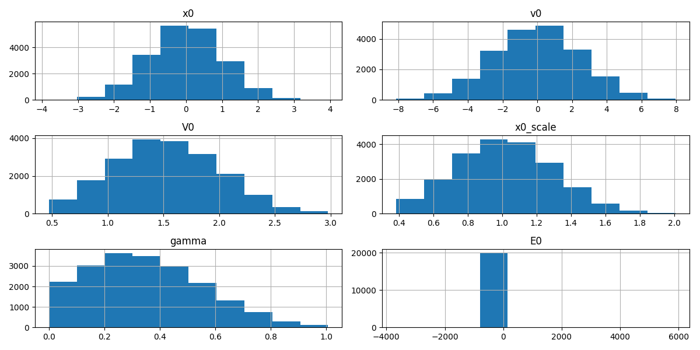
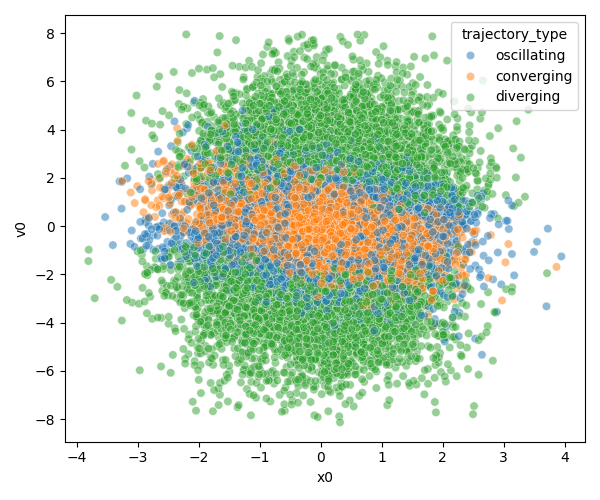
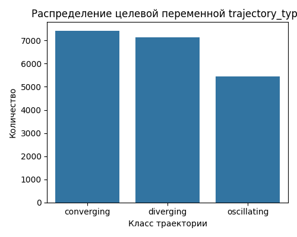
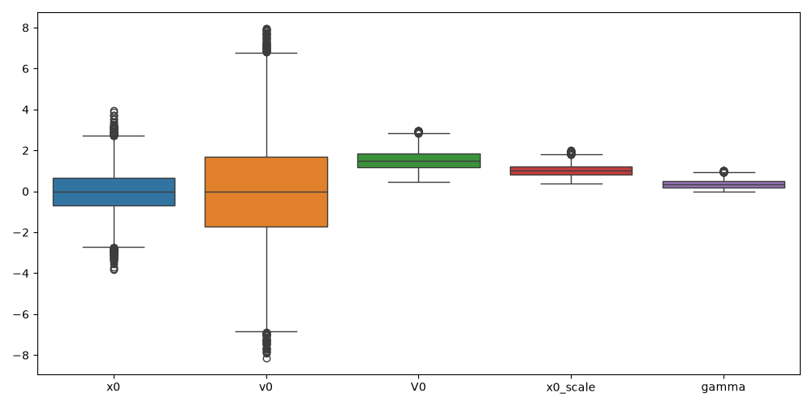
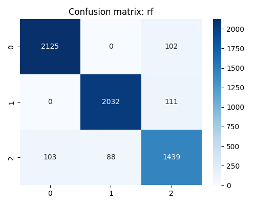
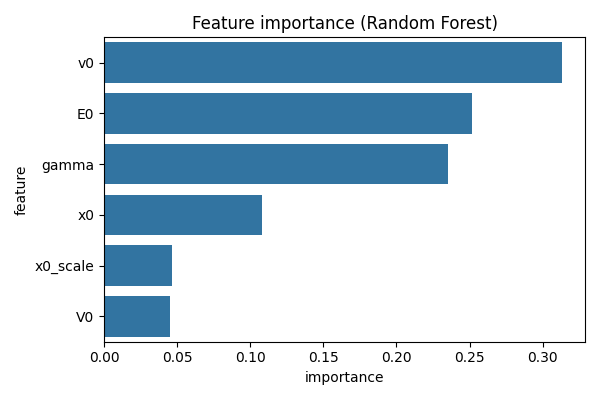
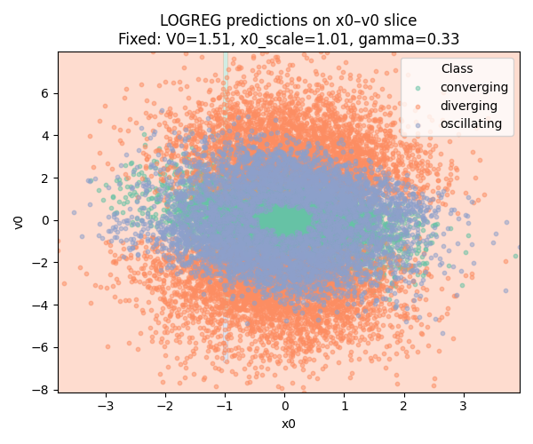

# Предсказательная аналитика поведения частицы и построение ML-пайплайна

## 📌 О проекте
В данном проекте реализован полный цикл построения предсказательной аналитики: от разведочного анализа данных до обучения и оценки моделей машинного обучения. 

В основе проекта лежит задача определения поведения физической частицы в потенциальном поле. Однако архитектура ML-пайплайна универсальна и адаптируется под бизнес-задачи.

## 📌 Описание физики задачи :)
Задача имитирует движение частицы в нелинейном потенциальном поле с учетом сил сопротивления. В зависимости от начальных условий, частица может либо преодолеть потенциальный барьер и улететь на бесконечность, либо остановиться в потенциальной яме, либо совершать в ней затухающие колебания.

**Исходные признаки (features)**
*   `x0` — начальная координата частицы.
*   `v0` — начальная скорость частицы.
*   `V0` — глубина (амплитуда) потенциальной ямы.
*   `x0_scale` — ширина ямы.
*   `gamma` — коэффициент диссипации (сопротивления среды).

Классы, которые предсказывает модель:
* `diverging` — частица улетает.
* `converging` — частица затухает в центре ямы.
* `oscillating` — частица совершает затухающие колебания.

## 📌 Стек

**Язык:** Python  
**Анализ данных:** Pandas, NumPy  
**Визуализация:** Matplotlib, Seaborn  
**Машинное обучение:** Scikit-learn, XGBoost  

## 📌 Этапы
1. **Разведочный анализ**
*   создан новый производный признак E0(начальная энергия), повышающий точность предсказания
*   построены гистограммы распределения всех числовых признаков
  

    
    

        Рис. 1. Гистограммы распределения признаков
    

*   построена диаграмма рассеяния в пространстве `x0`–`v0` с раскраской по классам
  

    
    

        Рис. 2. Диаграмма рассеяния в пространстве `x0`–`v0`
    

*   построен график распределения целевой переменной и рассчитаны доли классов (проверка на дисбаланс)
  

    
    

        Рис. 3. Распределение целевой переменной
    

*   построены боксплоты для выявления выбросов: отдельно для всех признаков (исключая `E0`) и отдельно для энергии `E0` в разрезе классов
  

    
    

        Рис. 4. Боксплоты признаков без энергии
    

*   построены плотностные гистограммы для каждого признака с разделением по классам

    
    

        Рис. 5. Распределение v_0 по классам
    

2. **Обучение и подбор гиперпараметров**
* реализована предобработка данных (`LabelEncoder` для целевой переменной, `StandardScaler` для признаков)
* обучены 3 модели: Logistic Regression, Random Forest и XGBoost
* использован `RandomizedSearchCV` с кросс-валидацией (`StratifiedKFold`) для поиска оптимальных гиперпараметров
3. **Оценка качества**
* в условиях дисбаланса классов использованы метрики **Balanced Accuracy** и **F1-macro**
* построены матрицы ошибок (Confusion Matrix)

    
    

        Рис. 6. Матрица ошибок для Random forest
    

* проанализирована важность признаков (Feature Importance) на основе Random Forest

    
    

        Рис. 7. Важность признаков
    

4. **Визуализация решений**
* построены двумерные срезы (пространство `x0`–`v0`) с наложением предсказанных классов моделей и реальных точек. Это позволяет визуально оценить границы принятия решений (Decision Boundaries) и увидеть, насколько точно модель разделяет классы траекторий

    
    

        Рис. 8. Срез для логистической регрессии
    

## 📌 Применимость в бизнесе
Хотя данные физические, методы, использованные в проекте, адаптируются под задачи бизнеса.
* **Data Science / ML / Риск-аналитика:** построение пайплайнов, работа с дисбалансом классов, подбор гиперпараметров, интерпретация моделей (Feature Importance).
* **Продуктовая аналитика:** поиск скрытых паттернов, сегментация объектов, визуализация и интерпретация результатов для принятия решений.

## 📌 Структура репозитория
* `Machine.py` — основной скрипт с ML-пайплайном
* `particle_trajectories.csv` — исходный датасет
* `requirements.txt` — зависимости проекта
* imgs/ — папка с графиками
